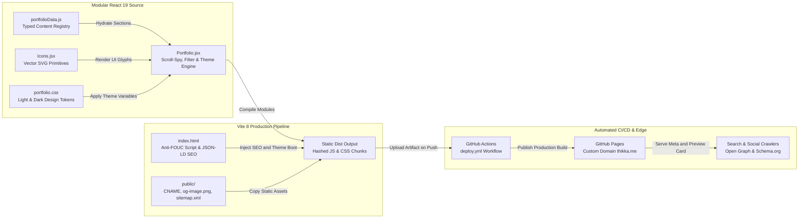

<div align="center">

# T. — Theekshana Sudeepa (`thikka.me`)

**Personal Engineering Portfolio — Full-Stack, Enterprise Java, IAM & AI Systems.**  
Built with React 19, Vite 8, first-class Light/Dark theme parity, accessible semantics, and automated GitHub Pages CI/CD.

[](https://thikka.me)
[](https://react.dev/)
[](https://vite.dev/)
[](.github/workflows/deploy.yml)
[](LICENSE)

</div>

---

## System Architecture



---

## Engineering Highlights

- **Modular Zero-Bloat Frontend:** Clean separation of data registry (`src/data/portfolioData.js`), vector icon primitives (`src/components/Icons.jsx`), design-token stylesheet (`src/styles/portfolio.css`), and accessible React 19 components (`src/Portfolio.jsx`) with zero runtime UI framework overhead.
- **First-Class Light & Dark Theme Parity:** CSS custom properties (`[data-theme="dark"]` and `[data-theme="light"]`) with WCAG AA+ text contrast, persistent `localStorage` state, and an inline pre-paint boot script in `index.html` to eliminate flash-of-wrong-theme (FOUC).
- **Interactive Domain Filtering & Scroll-Spy Navigation:** `IntersectionObserver`-driven section tracking, category-filtered showcase of live production and open-source work (`AI & Full-Stack`, `Enterprise & IAM`, `Mobile & Systems`), keyboard-accessible controls, and `@media (prefers-reduced-motion: reduce)` compliance.
- **Technical SEO & Social Preview Engineering:** Structured Schema.org JSON-LD (`Person`, `WebSite`), custom-rendered 1200×630 Open Graph card (`public/og-image.png`), semantic `<noscript>` crawler fallback, `robots.txt`, and canonical `sitemap.xml`.
- **Automated Deployment & Security Headers:** Zero-downtime deployment via GitHub Actions (`.github/workflows/deploy.yml`) to `thikka.me` (`CNAME`), paired with optional Vercel security headers (`vercel.json`) for `X-Content-Type-Options`, `X-Frame-Options`, and immutable asset caching.

---

## Selected Engineering Work Featured

| Project | Domain | Core Stack | Links |
| :--- | :--- | :--- | :--- |
| **Kasa AI Concierge** | Agentic Commerce · MCP | `Next.js 16` `TypeScript` `Vercel AI SDK` `MCP` | [Live](https://kasa-theta.vercel.app) · [GitHub](https://github.com/theekshana-sudeepa/kasa) |
| **Sillara Retail OS** | Offline-First Multi-Tenant POS | `React 19` `TypeScript` `Express` `Prisma` `MySQL 8` | [GitHub](https://github.com/theekshana-sudeepa/sillara) |
| **AutoBilling Engine** | Idempotent Billing & IaC | `React 19` `TypeScript` `Prisma` `MySQL` `AWS / OCI` | [GitHub](https://github.com/theekshana-sudeepa/autobilling) |
| **GlobalTrade SCM** | Enterprise Supply Chain | `Java` `Jakarta EE 10` `EJB 4.0` `Hibernate 6` `WildFly` | [GitHub](https://github.com/theekshana-sudeepa/globaltrade-scm) |
| **WSO2 Identity Integration** | Enterprise CIAM / OIDC | `WSO2 IS` `OIDC PKCE` `RS256 JWKS` `TypeScript` `Docker` | [GitHub](https://github.com/theekshana-sudeepa/wso2-identity-integration-demo) |
| **Nimithi Platform** | Bilingual Astronomical Engine | `Next.js` `TypeScript` `Swiss Ephemeris` `i18n` | [Live](https://nimithi.com) |
| **Tappsy Messaging Suite** | Real-Time Mobile Messaging | `React Native` `TypeScript` `Java EE` `WebSockets` | [App](https://github.com/theekshana-sudeepa/Tappsy) · [Backend](https://github.com/theekshana-sudeepa/TappsyBackEnd) |
| **Overdraft Roguelite** | Deterministic 60 Hz Systems | `C#` `Unity URP` `Zero-GC` `Spatial Hashing` | [GitHub](https://github.com/theekshana-sudeepa/overdraft-roguelite) |

---

## Repository Structure

```text
theekshana-sudeepa.github.io/
├── .github/
│   └── workflows/
│       └── deploy.yml            # Automated GitHub Pages build & deploy workflow
├── public/
│   ├── CNAME                     # Custom domain binding (thikka.me)
│   ├── favicon.svg               # Vector monogram favicon
│   ├── og-image.png              # 1200x630 Open Graph & social preview card
│   ├── robots.txt                # Search crawler directives
│   └── sitemap.xml               # Canonical XML sitemap
├── src/
│   ├── components/
│   │   └── Icons.jsx             # Reusable accessible SVG icon primitives
│   ├── data/
│   │   └── portfolioData.js      # Structured profile, track record, projects & stack data
│   ├── styles/
│   │   └── portfolio.css         # Light/Dark CSS custom properties & responsive layout
│   ├── Portfolio.jsx             # Main portfolio application & interactive hooks
│   └── main.jsx                  # React 19 StrictMode root mount
├── CNAME                         # Root custom domain record
├── LICENSE                       # MIT License
├── eslint.config.js              # ESLint 10 flat configuration (React Hooks + Refresh)
├── index.html                    # Entry document with anti-FOUC theme boot & JSON-LD
├── package.json                  # Project manifest & scripts
├── vercel.json                   # Optional Vercel SPA rewrites & security headers
└── vite.config.js                # Vite 8 build configuration
```

---

## Getting Started

### Prerequisites

- **Node.js** `20+`
- **npm** `10+`

### Local Development

```bash
# 1. Clone the repository
git clone https://github.com/theekshana-sudeepa/theekshana-sudeepa.github.io.git
cd theekshana-sudeepa.github.io

# 2. Install dependencies
npm install

# 3. Run the Vite development server
npm run dev
```

Open `http://localhost:5173` in your browser.

### Verification & Production Build

```bash
# Run ESLint across all modules
npm run lint

# Build optimized production bundle to dist/
npm run build

# Preview production build locally
npm run preview
```

---

## License

This project is licensed under the **MIT License** — see [LICENSE](LICENSE) for details.

---

<div align="center">

**Theekshana Sudeepa**  
[Portfolio (`thikka.me`)](https://thikka.me) · [LinkedIn](https://www.linkedin.com/in/theekshana-sudeepa/) · [GitHub](https://github.com/theekshana-sudeepa) · [LexoraTech](https://lexoratech.com)

</div>
