<div align="center">

# T. — Theekshana Sudeepa (`theekshana-sudeepa.github.io`)

**Personal Engineering Portfolio — TypeScript, React, UI/UX, AI/MCP, WSO2 IAM & Enterprise Java.**  
Built with strict TypeScript, React 19, Vite 8, build-time SSR pre-rendering, Light/Dark theme parity, unified Schema.org Knowledge Graph SEO, and automated GitHub Pages CI/CD.

[](https://theekshana-sudeepa.github.io/)
[](https://www.typescriptlang.org/)
[](https://react.dev/)
[](https://vite.dev/)
[](.github/workflows/deploy.yml)
[](LICENSE)

</div>

---

## System Architecture

```mermaid
flowchart LR
    subgraph Source["Strict TypeScript & React 19 Source"]
        Types["types/portfolio.ts<br/>Strict Domain Interfaces"]
        Data["data/portfolioData.ts<br/>Typed Content Registry"]
        Icons["components/Icons.tsx<br/>Exhaustive SVG Primitives"]
        Styles["styles/portfolio.css<br/>Light & Dark Design Tokens"]
        App["Portfolio.tsx<br/>Scroll-Spy, Filter & Theme Engine"]
    end

    subgraph Build["Typecheck, Vite 8 & SSR Pipeline"]
        TSC["tsc --noEmit & ESLint<br/>Zero-Any Strict Gate"]
        Entry["index.html & main.tsx<br/>Anti-FOUC Script & Hydrate Root"]
        SSR["entry-server.tsx & prerender.mjs<br/>React 19 renderToString Pre-Render"]
        Public["public/<br/>og-image, ICO/PNG Icons, 404, llms.txt"]
        Bundle["Static Pre-Rendered Dist<br/>Full HTML + Hydrated JS/CSS"]
    end

    subgraph Delivery["Automated CI/CD & Discovery"]
        GHA["GitHub Actions<br/>deploy.yml Workflow"]
        Pages["GitHub Pages<br/>theekshana-sudeepa.github.io"]
        Crawler["Search & AI Crawlers<br/>Wave-1 HTML, Open Graph & llms.txt"]
    end

    Types -->|Enforce Strict Contracts| Data
    Types -->|Type Props and Hooks| App
    Data -->|Hydrate Sections| App
    Icons -->|Render UI Glyphs| App
    Styles -->|Apply Theme Variables| App
    App -->|Verify Types and Lint| TSC
    TSC -->|Compile Client and SSR Bundles| SSR
    Entry -->|Inject SEO and Theme Boot| Bundle
    SSR -->|Inject Static HTML into Root| Bundle
    Public -->|Copy Static Assets| Bundle
    Bundle -->|Upload Artifact on Push| GHA
    GHA -->|Publish Production Build| Pages
    Pages -->|Serve Pre-Rendered HTML and Schema| Crawler
```



---

## Engineering & Technical SEO Highlights

- **Strict TypeScript Architecture (Zero `any`):** End-to-end strict TypeScript (`strict: true`, `verbatimModuleSyntax`, `noUnusedLocals`, `noUnusedParameters`, `@typescript-eslint/no-explicit-any: error`) with dedicated domain models in `src/types/portfolio.ts`, exhaustive icon union switching, and type-guarded DOM hooks.
- **Build-Time Static HTML Pre-Rendering (Zero Empty Root):** `scripts/prerender.mjs` compiles `src/entry-server.tsx` via Vite SSR, renders the full React 19 component tree via `renderToString` directly into `dist/index.html`, and hydrates cleanly with `hydrateRoot` + `useSyncExternalStore` — delivering complete Wave-1 HTML at `0ms`.
- **Canonical GitHub Pages SEO (`https://theekshana-sudeepa.github.io/`):** Strict canonical alignment across `<link rel="canonical">`, Open Graph (`profile` + 1200×630 `og-image.png`), multi-size Google SERP favicons (`favicon.ico`, `48x48`, `180x180`, `192x192`, `512x512`), `sitemap.xml`, `robots.txt`, `site.webmanifest`, `llms.txt`, and branded `404.html` (`noindex, follow`).
- **Accessibility, Theme Parity & Recruiter Print Mode:** First-class Dark/Light CSS tokens with WCAG AA+ contrast, anti-FOUC boot script, progressive scroll reveal (100% visible without JS), keyboard Skip-to-Content link, `prefers-reduced-motion` compliance, and `@media print` Save-as-PDF styling.

---

## Selected Engineering Work Featured

| Project | Domain | Core Stack | Links |
| :--- | :--- | :--- | :--- |
| **Kasa** | Agentic Commerce · Kapruka MCP | `Next.js 16` `React 19` `TypeScript` `Vercel AI SDK` `Kapruka MCP` | [GitHub](https://github.com/theekshana-sudeepa/kasa) |
| **Sillara** | Offline-First Multi-Tenant POS PWA | `React 19` `TypeScript` `Express` `Prisma` `MySQL 8` `AI OCR` | [GitHub](https://github.com/theekshana-sudeepa/sillara) |
| **AutoBilling** | Idempotent Recurring Billing & IaC | `React 19` `TypeScript` `Express` `Prisma` `PDF Engine` `AWS / OCI IaC` | [GitHub](https://github.com/theekshana-sudeepa/autobilling) |
| **WSO2 Identity & Asgardeo Integration Demo** | Enterprise CIAM / OIDC PKCE | `React 19` `TypeScript` `OIDC PKCE` `RS256 JWKS` `RBAC` `Docker` | [GitHub](https://github.com/theekshana-sudeepa/wso2-identity-integration-demo) · [wso2/docs-apim](https://github.com/wso2/docs-apim) |
| **GlobalTrade SCM** | Enterprise Java Supply Chain | `Jakarta EE 10` `EJB 4.0` `Hibernate 6` `JWT RBAC` `WildFly` | [GitHub](https://github.com/theekshana-sudeepa/globaltrade-scm) |
| **Nimithi Platform** | Bilingual Astronomical Engine | `Next.js` `TypeScript` `Swiss Ephemeris` `i18n` | [Live](https://www.nimithi.com/) |
| **Tappsy Messaging Suite** | Real-Time Mobile Messaging | `React Native` `TypeScript` `Java EE` `WebSockets` `MySQL` | [App](https://github.com/theekshana-sudeepa/Tappsy) · [Backend](https://github.com/theekshana-sudeepa/TappsyBackEnd) |
| **Overdraft Roguelite** | Deterministic 60 Hz Systems | `C#` `Unity URP` `Zero-GC` `Spatial Hashing` | [GitHub](https://github.com/theekshana-sudeepa/overdraft-roguelite) |

---

## Repository Structure

```text
theekshana-sudeepa.github.io/
├── .github/
│   └── workflows/
│       └── deploy.yml            # CI/CD: typecheck, lint, SSR build & GitHub Pages deploy
├── public/
│   ├── 404.html                  # Branded GitHub Pages 404 (noindex, follow)
│   ├── apple-touch-icon.png      # 180x180 iOS touch icon
│   ├── favicon-48x48.png         # 48x48 Google Search SERP favicon
│   ├── favicon.ico               # Multi-resolution ICO favicon (16/32/48)
│   ├── favicon.svg               # Vector monogram favicon
│   ├── google4f59002a2fd92773.html # Google Search Console ownership verification
│   ├── icon-192.png              # 192x192 PWA manifest icon
│   ├── icon-512.png              # 512x512 PWA manifest icon
│   ├── llms.txt                  # Structured AI/LLM search engine index
│   ├── og-image.png              # 1200x630 Open Graph & social preview card
│   ├── robots.txt                # Search crawler directives (full asset rendering)
│   ├── site.webmanifest          # PWA manifest metadata
│   └── sitemap.xml               # Canonical XML sitemap
├── scripts/
│   └── prerender.mjs             # Build-time React 19 SSR HTML pre-renderer
├── src/
│   ├── components/
│   │   └── Icons.tsx             # Strictly typed SVG icon primitives
│   ├── data/
│   │   └── portfolioData.ts      # Typed profile, experience, projects & stack registry
│   ├── styles/
│   │   └── portfolio.css         # Light/Dark design tokens, print styles & responsive layout
│   ├── types/
│   │   └── portfolio.ts          # Domain TypeScript interfaces & strict union types
│   ├── Portfolio.tsx             # Main portfolio application & hydration-safe hooks
│   ├── entry-server.tsx          # React 19 renderToString server entry
│   └── main.tsx                  # Smart hydrateRoot / createRoot client mount
├── LICENSE                       # MIT License
├── eslint.config.js              # ESLint 10 + typescript-eslint flat configuration
├── index.html                    # Entry document with anti-FOUC boot & Schema.org @graph
├── package.json                  # Project manifest & scripts
├── tsconfig.json                 # Strict TypeScript compiler configuration
├── vercel.json                   # Optional SPA rewrites & security headers
└── vite.config.ts                # Vite 8 TypeScript build configuration
```

---

## Getting Started

### Prerequisites

- **Node.js** `20+`
- **npm** `10+`

### Local Development

```bash
# 1. Clone the repository
git clone https://github.com/theekshana-sudeepa/theekshana-sudeepa.github.io.git
cd theekshana-sudeepa.github.io

# 2. Install dependencies
npm install

# 3. Run the Vite development server
npm run dev
```

Open `http://localhost:5173` in your browser.

### Verification & Production Build

```bash
# Strict TypeScript type-check (zero emit)
npx tsc --noEmit

# Run ESLint across all TypeScript and script modules
npm run lint

# Build optimized production bundle & SSR pre-render to dist/
npm run build

# Preview pre-rendered production build locally
npm run preview
```

---

## License

This project is licensed under the **MIT License** — see [LICENSE](LICENSE) for details.

---

<div align="center">

**Theekshana Sudeepa**  
[Portfolio (`theekshana-sudeepa.github.io`)](https://theekshana-sudeepa.github.io/) · [LinkedIn](https://www.linkedin.com/in/theekshana-sudeepa/) · [GitHub](https://github.com/theekshana-sudeepa)

</div>
