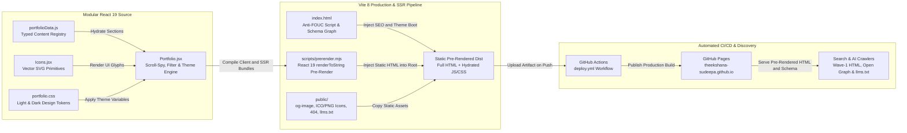

<div align="center">

# T. — Theekshana Sudeepa (`theekshana-sudeepa.github.io`)

**Personal Engineering Portfolio — Full-Stack, Enterprise Java, IAM & AI Systems.**  
Built with React 19, Vite 8, first-class Light/Dark theme parity, unified Schema.org Knowledge Graph SEO, and automated GitHub Pages CI/CD.

[](https://theekshana-sudeepa.github.io/)
[](https://react.dev/)
[](https://vite.dev/)
[](.github/workflows/deploy.yml)
[](LICENSE)

</div>

---

## System Architecture



---

## Engineering & Technical SEO Highlights

- **Build-Time Static HTML Pre-Rendering (Zero Empty Root):** `scripts/prerender.mjs` renders the full React 19 component tree via `renderToString` directly into `dist/index.html` and hydrates seamlessly with `hydrateRoot` + `useSyncExternalStore` — giving Googlebot Wave-1, Bingbot, and AI crawlers complete HTML at `0ms` with near-instant FCP/LCP.
- **Canonical GitHub Pages SEO (`https://theekshana-sudeepa.github.io/`):** Strict canonical alignment across `<link rel="canonical">`, Open Graph (`profile` + 1200×630 `og-image.png`), multi-size Google SERP favicons (`favicon.ico`, `48x48`, `180x180`, `192x192`, `512x512`), `sitemap.xml`, `robots.txt` (with `/assets/` crawlable), `site.webmanifest`, `llms.txt`, and branded `404.html` (`noindex, follow`).
- **Unified Schema.org `@graph` & `rel="me"` Identity:** Interlinked JSON-LD entities (`ProfilePage`, `Person`, `WebSite`, and `ItemList` of `SoftwareSourceCode` repositories), bidirectional `rel="me"` links to GitHub & LinkedIn, and a single semantic `<h1>`.
- **Accessibility, Theme Parity & Recruiter Print Mode:** First-class Dark/Light CSS tokens with WCAG AA+ contrast, anti-FOUC boot script, progressive scroll reveal (100% visible without JS), keyboard Skip-to-Content link, `prefers-reduced-motion` compliance, and a clean `@media print` Save-as-PDF layout.

---

## Selected Engineering Work Featured

| Project | Domain | Core Stack | Links |
| :--- | :--- | :--- | :--- |
| **Kasa AI Concierge** | Agentic Commerce · MCP | `Next.js 16` `TypeScript` `Vercel AI SDK` `MCP` | [GitHub](https://github.com/theekshana-sudeepa/kasa) |
| **Sillara Retail OS** | Offline-First Multi-Tenant POS | `React 19` `TypeScript` `Express` `Prisma` `MySQL 8` | [GitHub](https://github.com/theekshana-sudeepa/sillara) |
| **AutoBilling Engine** | Idempotent Billing & IaC | `React 19` `TypeScript` `Prisma` `MySQL` `AWS / OCI` | [GitHub](https://github.com/theekshana-sudeepa/autobilling) |
| **GlobalTrade SCM** | Enterprise Supply Chain | `Java` `Jakarta EE 10` `EJB 4.0` `Hibernate 6` `WildFly` | [GitHub](https://github.com/theekshana-sudeepa/globaltrade-scm) |
| **WSO2 Identity Integration** | Enterprise CIAM / OIDC | `WSO2 IS` `OIDC PKCE` `RS256 JWKS` `TypeScript` `Docker` | [GitHub](https://github.com/theekshana-sudeepa/wso2-identity-integration-demo) |
| **Nimithi Platform** | Bilingual Astronomical Engine | `Next.js` `TypeScript` `Swiss Ephemeris` `i18n` | [Live](https://www.nimithi.com/) |
| **Tappsy Messaging Suite** | Real-Time Mobile Messaging | `React Native` `TypeScript` `Java EE` `WebSockets` | [App](https://github.com/theekshana-sudeepa/Tappsy) · [Backend](https://github.com/theekshana-sudeepa/TappsyBackEnd) |
| **Overdraft Roguelite** | Deterministic 60 Hz Systems | `C#` `Unity URP` `Zero-GC` `Spatial Hashing` | [GitHub](https://github.com/theekshana-sudeepa/overdraft-roguelite) |

---

## Repository Structure

```text
theekshana-sudeepa.github.io/
├── .github/
│   └── workflows/
│       └── deploy.yml            # Automated GitHub Pages build & deploy workflow
├── public/
│   ├── 404.html                  # Branded GitHub Pages 404 (noindex, follow)
│   ├── apple-touch-icon.png      # 180x180 iOS touch icon
│   ├── favicon-48x48.png         # 48x48 Google Search SERP favicon
│   ├── favicon.ico               # Multi-resolution ICO favicon (16/32/48)
│   ├── favicon.svg               # Vector monogram favicon
│   ├── google4f59002a2fd92773.html # Google Search Console ownership verification
│   ├── icon-192.png              # 192x192 PWA manifest icon
│   ├── icon-512.png              # 512x512 PWA manifest icon
│   ├── llms.txt                  # Structured AI/LLM search engine index
│   ├── og-image.png              # 1200x630 Open Graph & social preview card
│   ├── robots.txt                # Search crawler directives (full asset rendering)
│   ├── site.webmanifest          # PWA manifest metadata
│   └── sitemap.xml               # Canonical XML sitemap
├── scripts/
│   └── prerender.mjs             # Build-time React 19 SSR HTML pre-renderer
├── src/
│   ├── components/
│   │   └── Icons.jsx             # Reusable accessible SVG icon primitives
│   ├── data/
│   │   └── portfolioData.js      # Structured profile, track record, projects & stack data
│   ├── styles/
│   │   └── portfolio.css         # Light/Dark design tokens, print styles & responsive layout
│   ├── Portfolio.jsx             # Main portfolio application & hydration-safe hooks
│   ├── entry-server.jsx          # React 19 renderToString server entry
│   └── main.jsx                  # Smart hydrateRoot / createRoot client mount
├── LICENSE                       # MIT License
├── eslint.config.js              # ESLint 10 flat configuration (React Hooks + Refresh)
├── index.html                    # Entry document with anti-FOUC boot & Schema.org @graph
├── package.json                  # Project manifest & scripts
├── vercel.json                   # Optional SPA rewrites & security headers
└── vite.config.js                # Vite 8 build configuration
```

---

## Getting Started

### Prerequisites

- **Node.js** `20+`
- **npm** `10+`

### Local Development

```bash
# 1. Clone the repository
git clone https://github.com/theekshana-sudeepa/theekshana-sudeepa.github.io.git
cd theekshana-sudeepa.github.io

# 2. Install dependencies
npm install

# 3. Run the Vite development server
npm run dev
```

Open `http://localhost:5173` in your browser.

### Verification & Production Build

```bash
# Run ESLint across all modules
npm run lint

# Build optimized production bundle to dist/
npm run build

# Preview production build locally
npm run preview
```

---

## License

This project is licensed under the **MIT License** — see [LICENSE](LICENSE) for details.

---

<div align="center">

**Theekshana Sudeepa**  
[Portfolio (`theekshana-sudeepa.github.io`)](https://theekshana-sudeepa.github.io/) · [LinkedIn](https://www.linkedin.com/in/theekshana-sudeepa/) · [GitHub](https://github.com/theekshana-sudeepa) · [LexoraTech](https://lexoratech.com)

</div>
